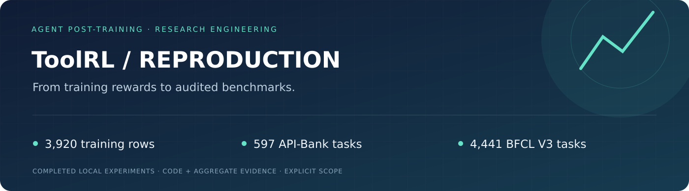
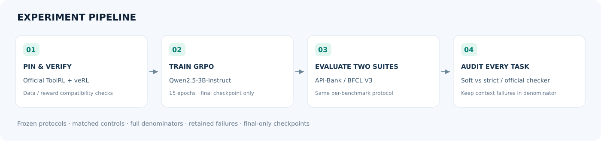
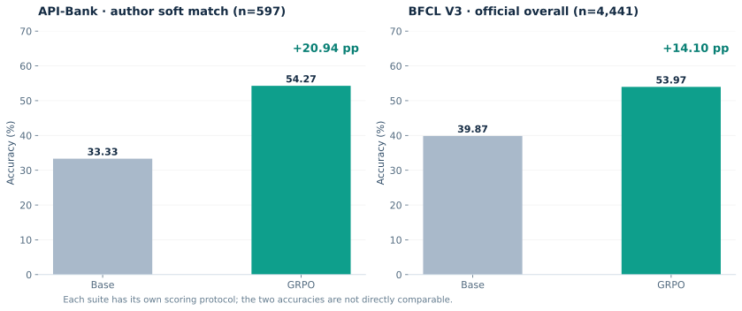

# ToolRL training and audited benchmark reproduction

[中文](README.md) · [Protocol](docs/methodology.md) · [Results](docs/results.md) · [Run guide](docs/reproducibility.md)

An engineering reproduction built on the official ToolRL/veRL implementation: legacy GPU environment adaptation, Qwen2.5-3B GRPO training, and complete API-Bank/BFCL V3 evaluations.




| Benchmark | Base | GRPO |
|---|---:|---:|
| API-Bank597, author soft match |33.33%|**54.27%**|
| API-Bank597, strict single-call diagnostic |32.33%|**52.26%**|
| BFCL V3 4441, official Overall |39.87%|**53.97%**|

All tasks remain in the denominator, including55/25 base/GRPO context-budget failures. Infrastructure errors are zero. API-Bank soft and strict rules are reported separately; BFCL multi-turn remains weak at5.25% after training.

```bash
python examples/demo.py
make check
python scripts/report.py
```

Training uses3920 examples and15epochs, a4608-token prompt cap rather than2048, explicit zero reward KL, and a pinned BFCL V3 revision. The original paper's exact BFCL commit is unknown. Bamboogle was not evaluated. These results do not claim full paper metric reproduction or a new RL algorithm.

[Evidence](results/benchmarks.json) · [Sources](docs/references.md) · [Apache-2.0](LICENSE). Model weights and raw datasets are obtained separately.
