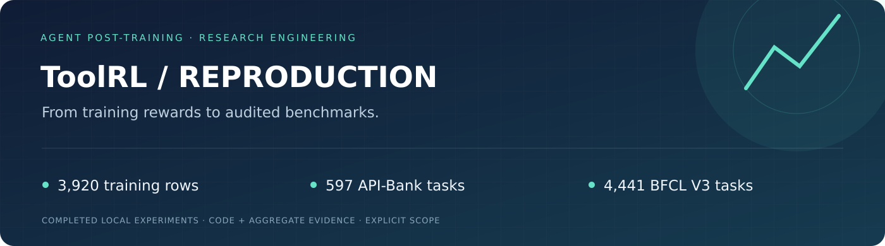
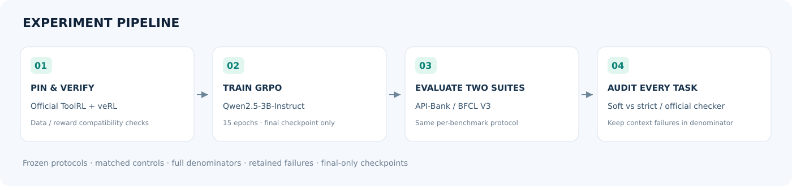
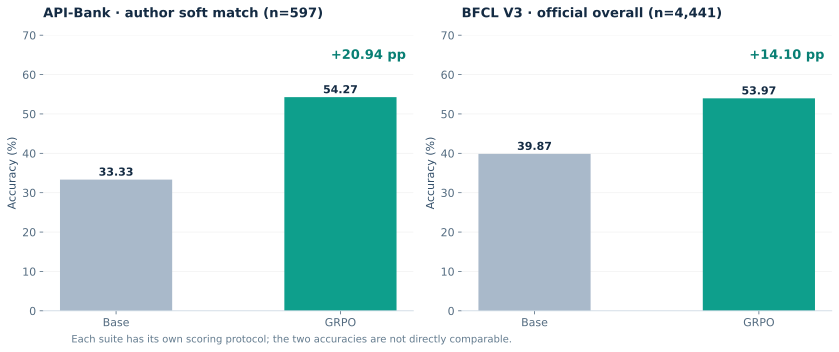

<div align="center">



**工具调用强化学习复现工程：完整训练、双基准接入与逐任务评测审计**

[](https://github.com/carlyer/toolrl-reproduction/actions/workflows/validate.yml)


[English](README.en.md) · [方法与协议](docs/methodology.md) · [实验结果](docs/results.md) · [复现指南](docs/reproducibility.md) · [简历表述](docs/resume.md)

</div>

## 背景与目标

工具调用RL的训练reward并不等于真实benchmark accuracy。本项目基于官方 ToolRL/veRL，完成旧版本GPU训练环境适配、Qwen2.5-3B-Instruct的GRPO训练，以及API-Bank与BFCL V3的完整对照评测，重点解决**版本可追溯、协议一致、完整分母和失败分类**。

已完成3,920训练样本、15 epochs训练，以及每个模型597条API-Bank和4,441条BFCL V3评测。**Bamboogle未运行，不能称为整篇论文指标复现。**

## Pipeline



## 双基准结果



| 基准与评分 | Base | GRPO | 变化 |
|---|---:|---:|---:|
| API-Bank，作者宽松匹配，597条 | 33.33% | **54.27%** | **+20.94 pp** |
| API-Bank，严格单调用诊断 | 32.33% | **52.26%** | +19.93 pp |
| BFCL V3，官方Overall，4,441条 | 39.87% | **53.97%** | **+14.10 pp** |

两套benchmark的评分协议不同，不能横向把准确率当成同一指标。API-Bank作者宽松评分已在两模型共1,194条预测上逐条对齐；严格单调用结果单独披露。[汇总证据](results/benchmarks.json)

| BFCL V3 分项 | Base | GRPO |
|---|---:|---:|
| Non-Live AST |45.10%|83.17%|
| Live |64.15%|71.88%|
| Multi Turn |1.62%|5.25%|
| Relevance |66.67%|83.33%|
| Irrelevance |79.86%|84.85%|

多轮能力仍弱，不能由整体53.97%推断稳定的多轮agent表现。Base/GRPO分别有55/25条上下文预算失败，全部保留在评分分母；基础设施错误为0。

## 主要工程工作

- 固定官方ToolRL与BFCL V3提交，隔离旧训练环境与新checker环境。
- 保留全部训练样本；将prompt上限从2048扩到4608并披露差异。
- 完成GRPO训练，只保存最终checkpoint，避免周期性基础模型/优化器副本。
- 接入官方API-Bank提示与soft-match，并增加strict诊断。
- 适配BFCL版本接口，使用每请求独立Dialogue，保留官方generator/checker。
- 校验每模型4,441个唯一ID；区分模型上下文失败和连接/服务等基础设施错误。

## 快速体验：无需GPU

```bash
python examples/demo.py
make check
python scripts/report.py
```

CPU演示展示作者soft-match为什么可能与strict不同。测试验证完整分母、错误工具拒绝、上下文失败保留和基础设施错误中止。重绘图表：`pip install -r requirements-viz.txt && make figures`。

## 运行入口

```bash
bash scripts/bootstrap_upstream.sh
# 在独立的兼容CUDA环境安装Torch2.4/vLLM0.6.3及官方veRL依赖
export BASE_MODEL="$PWD/models/Qwen2.5-3B-Instruct"
CUDA_VISIBLE_DEVICES=0,1,2,3 N_GPUS=4 bash scripts/train.sh smoke
# smoke通过后才运行完整训练
bash scripts/train.sh full

.venv/bin/python scripts/evaluation/api_bank.py \
  --model "$BASE_MODEL" --output results/runs/api-base --preflight
```

安装、模型下载、BFCL环境与补丁步骤见[复现指南](docs/reproducibility.md)。历史最终模型不随本仓库分发。

## 仓库结构

```text
scripts/train.sh              官方veRL训练入口的本地适配
scripts/evaluation/           API-Bank评测、BFCL流水线与完整性审计
notes/*.patch                 版本兼容与最终checkpoint补丁
configs/                      模型路径与历史依赖版本
results/benchmarks.json        两套已完成基准的汇总
tests/                        评分与失败分母回归验证
docs/                         方法、结果、复现与可视化
```

## 范围与归属

训练算法与原始奖励来自[官方ToolRL](https://github.com/qiancheng0/ToolRL)，BFCL来自[官方Gorilla](https://github.com/ShishirPatil/gorilla)。本地贡献是运行适配、双基准集成、协议核验和结果审计；不把复现工程写成新RL算法。[引用与版本](docs/references.md) · [Apache-2.0](LICENSE) · [NOTICE](NOTICE)
